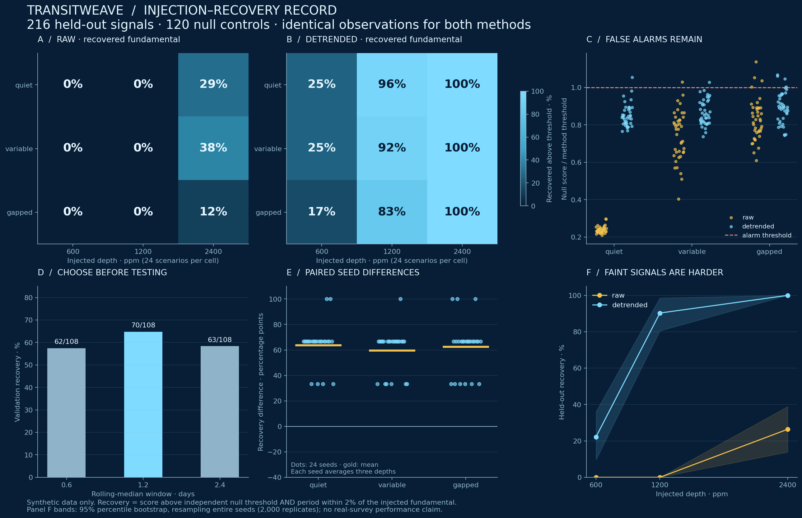
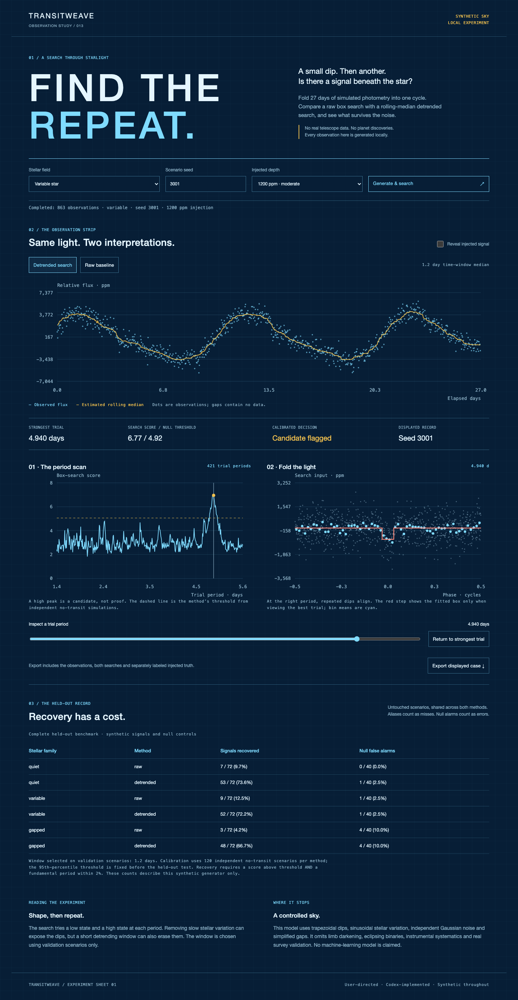
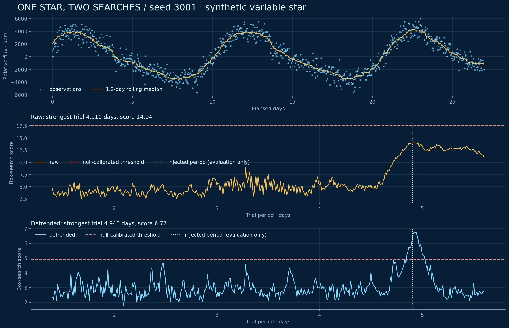

# Problem Statement

**Can a repeating transit-like dip be recovered from variable starlight without mistaking the star's own variability for a signal?**

TransitWeave is a local astronomy experiment: generate 27 days of **synthetic photometry**, search for repeating dips, and compare an untreated box-search baseline with a validation-selected rolling-median detrending pipeline. Inputs are a scenario seed, stellar family and injected depth. Outputs are the observed light curve, trial-period scores, phase-folded observations and a calibrated candidate flag. Success requires both a score above an independently calibrated threshold **and** recovery of the injected fundamental period within 2%.



**No real telescope data, discoveries, hardware, paid services or API keys.** This project uses numerical simulation and an explicit statistical search; it does not claim a trained ML model. The question is narrow enough to test directly without one.

## Run the interactive experiment

Python **3.12–3.14** and a browser. Local validation and CI use Python 3.14.

```sh
git clone https://github.com/mirmoosa1014-rgb/transitweave.git
cd transitweave
python3 -m venv .venv
.venv/bin/python -m pip install -r requirements.txt
.venv/bin/python -m transitweave.server
```

Open **http://127.0.0.1:8766**. On Windows, use `.venv\Scripts\python` in place of `.venv/bin/python`. Stop with Ctrl+C. The repository does not itself host the application. After installing NumPy, the app runs offline; there are no external fonts or JavaScript services.

- Generate quiet, variable or gapped observations with a selected seed and depth, including a zero-depth null control.
- Switch between the raw baseline and detrended search on the **same observations**.
- Scrub all 421 trial periods and watch the phase fold change; return to the strongest trial.
- Reveal evaluator-only injected truth, compare it with the estimated period, and export the actual displayed run as JSON.
- Use keyboard controls, a mobile layout, and reduced-motion preferences. Wide mobile plots/tables scroll within their own regions.



[Mobile screenshot](docs/images/app-mobile.png) · [90-second demo](docs/demo.md)

## Measured results

The full experiment performs **1,476 searches**: 480 null-calibration searches, 324 validation searches, and 672 held-out evaluations (216 signals + 120 null cases, each evaluated by two methods). Seeds are disjoint between these stages. Family/depth variants share scenario seeds and are deliberately paired.

A **1.2-day** median window won validation with **70/108** recovered signals, compared with 62/108 for 0.6 days and 63/108 for 2.4 days. It was then frozen.

| Held-out family | Raw recovery | Detrended recovery | Raw null alarms | Detrended null alarms |
|---|---:|---:|---:|---:|
| Quiet | 7/72 (9.7%) | 53/72 (73.6%) | 0/40 | 1/40 |
| Variable | 9/72 (12.5%) | 52/72 (72.2%) | 1/40 | 1/40 |
| Variable + gaps | 3/72 (4.2%) | 48/72 (66.7%) | 4/40 | 4/40 |
| **Total** | **19/216 (8.8%)** | **153/216 (70.8%)** | **5/120 (4.2%)** | **6/120 (5.0%)** |

**Interpretation matters:** each method uses one threshold pooled over all three calibration families. Strong stellar variability forces the raw threshold upward (17.60 versus 4.92 for detrended), making it especially conservative on quiet stars. Ignoring the threshold, the raw search finds the right period in 89/216 cases, versus 168/216 after detrending. Thus the headline recovery comparison reflects both period finding and the chosen pooled false-alarm policy. It does **not** establish superiority over a family-specific calibrated baseline, Astropy BLS, or a production survey pipeline.

The gap family still produces **10% null alarms** for both methods. A nominal 95th-percentile calibration threshold is not a guarantee of 5% error within every family or on real data. The faintest injections remain difficult. Half/double-period aliases count as failures. Figure bands resample **whole seeds**, not individual observations, to preserve paired dependence.



[Raw CSV](results/benchmark.csv) · [Full JSON](results/benchmark.json) · [Calibration scores](results/calibration.json) · [Frozen configuration](results/config.json) · [Evaluation protocol](docs/evaluation.md)

## Reproduce and verify

```sh
.venv/bin/python -m pip install -r requirements-dev.lock
.venv/bin/python -m pytest -q
.venv/bin/python -m transitweave.experiment --quick
.venv/bin/python -m transitweave.experiment --output artifacts/reproduction
.venv/bin/python scripts/figures.py
```

Quick mode writes only `artifacts/quick`; its tiny sample is a smoke check, not the published study. The full command above preserves committed evidence. Running without `--output` replaces `results/` intentionally. Numerical outputs reproduce from seeds; recorded wall-clock timings vary with the machine. Figures read the committed `results/` files.

Optional browser validation needs Node.js 22+:

```sh
npm ci
npx playwright install chromium
npm run test:browser
```

The browser suite starts its own loopback server on port 18766 and stops it afterward. `TRANSITWEAVE_PYTHON` can select a different Python executable. Browser screenshots are regenerated in `docs/images`. CI runs Python tests, the quick experiment, and Chromium interactions. There is no frontend bundler or build step: the app is native HTML/CSS/JavaScript.

## Scope and limitations

The generator models trapezoidal transit-like dips, sinusoidal stellar variability, a fixed 800-ppm independent Gaussian noise level, random missing samples and one observing gap. It is **not a physical transit forward model**: limb darkening, stellar radii, orbital geometry, exposure integration, binaries, red noise and instrumental effects are absent. The detector knows the nominal noise specification, not the hidden injected period or shape. It searches only 1.4–5.6 days, with 128 phase bins and four box widths; finite resolution can miss signals. Median filtering uses the full observation sequence, including later samples, so this is an **offline** search, not causal streaming.

The score is a fixed-box least-squares statistic, not a calibrated planet probability. No real telescope or unbuilt hardware is represented as tested. Synthetic success cannot establish field performance.

[Architecture](docs/architecture.md) · [Statistical model](docs/model.md) · [Explanation and reviewer questions](docs/explain.md) · [Project summary](docs/project-summary.md) · [Design provenance](docs/design.md)

## References and contributions

The binned two-level search follows the general box-fitting approach described by [Kovács, Zucker & Mazeh (2002)](https://doi.org/10.1051/0004-6361:20020802) and the [NASA Exoplanet Archive algorithm guide](https://exoplanetarchive.ipac.caltech.edu/docs/pgram/pgram_algo.html). This is an independent, simplified implementation, not their software. [Method details](docs/model.md) identify its specific scoring and calibration choices.

Visual direction draws on the Blueprint style in [TheRollerBlader/motion-graphic-style-library](https://github.com/TheRollerBlader/motion-graphic-style-library), with attribution and the upstream license in [THIRD_PARTY_NOTICES.md](THIRD_PARTY_NOTICES.md).

The repository owner supplied project interests, quality requirements and authorization for autonomous work. **Codex selected this scoped experiment and implemented the simulation, search, app, evaluation, documentation and tests.** Subsequent human review or modifications should be credited when they occur. No claim is made that the owner mainly wrote this code or that assistance was slight.
