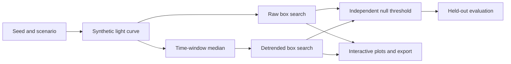

# Architecture

- `simulation.py`: deterministic observations and separate evaluation truth.
- `search.py`: array validation, elapsed-time median, binned box fitting and evaluation-only recovery check.
- `experiment.py`: disjoint split orchestration, calibration, parameter selection, CSV/JSON evidence.
- `server.py`: loopback-only standard-library HTTP service. `POST /api/run` accepts only seed, family and depth; `GET /api/meta` returns the frozen published configuration and summary. One simulation runs at a time; another receives 429. A 512-byte body limit and bounded simulator parameters cap ordinary local workload. This is not an internet-facing service.
- `web/`: native SVG charts and controls. No frontend framework, external CDN, data service, bundler or production build is necessary.
- `scripts/figures.py`: standalone research plates from saved evidence; no hand-entered plot metrics.

The server reads the committed benchmark at startup and does not write results. Experiments and plot generation are explicit CLI operations. Browser tests use a dedicated port and cannot silently reuse an old app. Failed or pending requests disable export; exported filenames and labels identify the displayed completed case. Revealed truth stays separate from detector inputs.
